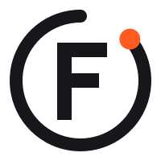

<picture>
  <source media="(prefers-color-scheme: dark)" srcset="assets/banner-dark.svg">
  
</picture>

  <a href="https://fermulate.com"><b>fermulate.com</b></a>&nbsp;&nbsp;&nbsp;&nbsp;
  <a href="https://github.com/Fermulate">GitHub</a>&nbsp;&nbsp;&nbsp;&nbsp;
  <a href="https://www.linkedin.com/company/fermulate">LinkedIn</a>&nbsp;&nbsp;&nbsp;&nbsp;
  <a href="#have-a-headache">Send us a headache</a>

 

## Hi, we're Fermulate

We're a few friends studying computer science, with a low tolerance for small annoyances. When something in our day could work better, we build the fix, use it ourselves, and then publish it here so it can fix your day too.

Everything we make is free and open source. Use it, read it, fork it, improve it.

The whole story, the projects and the people behind them live at **[fermulate.com](https://fermulate.com)**.

## Why "Fermulate"

It's a play on "formulate", because that's what we do: we make things, and we formulate software. It's spelled FER (Ferrin) + MU (Musa) + LATE, because those two kept running late to class. We liked the joke enough to design around it: the ring in our logo is a clock that never quite reaches twelve, and the orange dot is where it actually got to.

## What comes out of here

| Kind | What it means |
| --- | --- |
| New tools | Problems we couldn't find a good answer to, so we wrote one. |
| Free alternatives | The thing you already use, minus the subscription. |
| Mashups | Several tools that should have been one app, made into one app. |

## Projects

| Project | The headache | Status |
| --- | --- | --- |
| [Potluck](https://github.com/Fermulate/potluck) | Splitting the bill and planning the day with a group, in one place instead of three apps. Free, open source expense splitting and group event planning. | Live, early development: [app](https://potluck.fermulate.com), [guide](https://docs.potluck.fermulate.com) |

More are cooking. Hit **Watch** on this org and GitHub will tell you when they land.

## How we work

- We fix our own headache first. If it doesn't help us, it doesn't ship.
- We ship it free. No trials, no "pro" tier, no telemetry.
- We keep the code readable. Someone learning should be able to follow it.
- We check what exists before we build. Combining two good tools beats writing a third.

## Have a headache?

Tell us what's annoying you. If it annoys us too, it goes on the list.

Open an issue on the project it belongs to, or start a thread in [Discussions](https://github.com/orgs/Fermulate/discussions) if it doesn't belong anywhere yet. Pull requests are welcome on everything.

## Find us

- Website: [fermulate.com](https://fermulate.com)
- People: [fermulate.com/people](https://fermulate.com/people/)
- GitHub: [github.com/Fermulate](https://github.com/Fermulate)
- LinkedIn: [linkedin.com/company/fermulate](https://www.linkedin.com/company/fermulate)
- Ideas and questions: [Discussions](https://github.com/orgs/Fermulate/discussions)

  <picture>
    <source media="(prefers-color-scheme: dark)" srcset="assets/mark-dark.svg">
    
  </picture>

